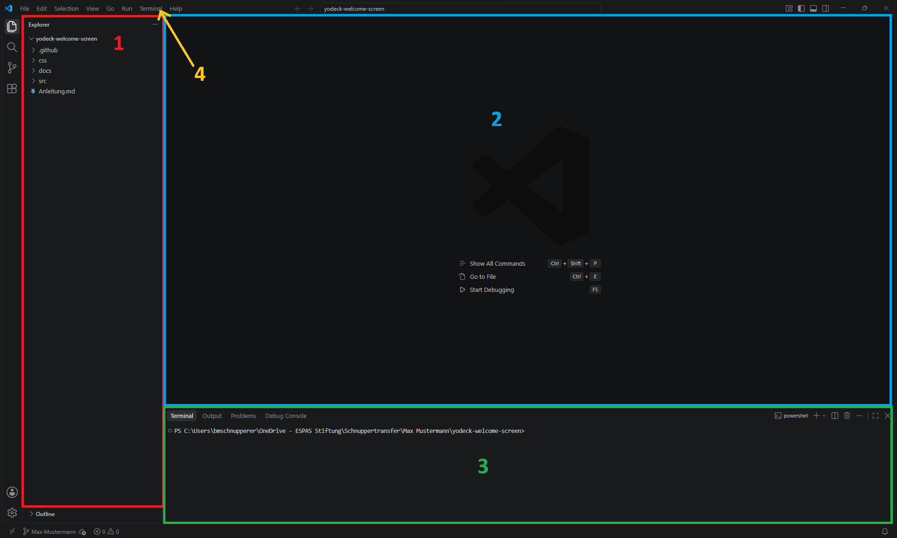
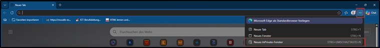
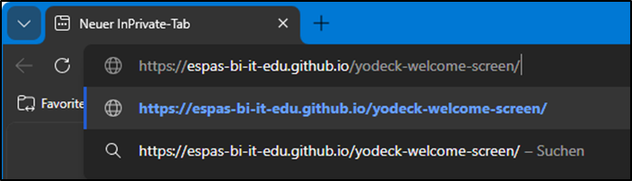

# Yodeck Welcome Screen

Wilkommen beim **Yodeck Welcome Screen Projekt**! Hier wirst Du einfache Änderungen an einer Webseite vornehmen können und lernst einige grundlegende **Git**-Befehle kennen.

## 1 - Projekt aufsetzen

Damit Du überhaupt mit dem Yodeck-Projekt anfangen kannst, musst Du es zuerst aus dem Internet herunterladen. Code-Projekte wie dieses hier werden oftmals in sogenannten **Repositories** auf **GitHub** (wo Du dich im Moment auch gerade befindest) abgelegt und können von da **geklont** werden. Ein Klon ist eine lokale Kopie der GitHub-Repository auf Deinem Computer, auf welcher Du arbeiten kannst.

### 1.1 - Repository klonen

Öffne ein Terminal und navigiere zu Deinem persönlichen Ordner auf dem OneDrive:

```sh
cd 'C:\Users\bmschnupperer\OneDrive - ESPAS Stiftung\Schnuppertransfer\Vorname Nachname'
```

> [!IMPORTANT]
> Ersetze im Befehl `Vorname Nachname` mit Deinem eigenen Namen.
>
> Beispiel:
>
> ```sh
> cd 'C:\Users\bmschnupperer\OneDrive - ESPAS Stiftung\Schnuppertransfer\Max Mustermann'
> ```

Jetzt bist Du am richtigen Ort, um das Projekt herunterzuladen. Mit dem folgenden Befehl erstellst Du eine lokale Kopie, auf welcher Du arbeiten kannst:

```sh
git clone https://github.com/espas-bi-it-edu/yodeck-welcome-screen.git
```

Navigiere nun in den neu erstellten Ordner der Repository:

```sh
cd .\yodeck-welcome-screen
```

### 1.2 - Eigenen Branch erstellen

Als Erstes erstellst Du Deinen eigenen **Branch** (auf deutsch **Ast**) des Projekts. Auf Branches können Entwickler Änderungen am Code vornehmen, ohne den **`main`-Branch**, also den **Hauptbranch** oder **Stamm** des Projekts, oder die Branches Anderer zu beeinträchtigen.

Führe den folgenden Befehl aus:

```sh
git checkout -b Vorname-Nachname
```

> [!IMPORTANT]
> Ersetze `Vorname-Nachname` mit Deinem eigenen Namen **mit** Bindestrichen dazwischen!
>
> Beispiel:
>
> ```sh
> git checkout -b Max-Mustermann
> ```

Nun existiert Dein Branch bei Dir auf dem Computer, also **lokal**. Damit er aber auch auf der GitHub Repository im Internet, also auf dem sogenannten **remote** existiert, musst Du ihn mit einem **`push`** hochladen. Verwende dafür den Befehl:

```sh
git push -u origin Vorname-Nachname
```

Der Befehl erstellt Deinen Branch auf dem GitHub Repository und **verlinkt** ihn mit Deinem **lokalen Branch**. Wenn Du dann in den nächsten Schritten Änderungen am Code vornimmst und diese auf GitHub hochlädst, weiss Git nun, wo es die Aktualisierungen hinlegen muss.

Jetzt bist Du bereit, dich in den Code zu stürzen.

## 2 - Code anpassen

In den nächsten Schritten wirst Du Anpassungen am Code vornehmen. Dafür brauchen wir einen passenden Editor, in welchen Du diese Dateien sehen und bearbeiten kannst. Für diese Aufgabe verwendest Du **Visual Studio Code**. Du kannst das Programm mit dem Yodeck-Projekt ganz einfach mit dem folgenden Befehl öffnen:

```sh
code .
```

Visual Studio Code ist eine Entwicklungsumgebung, in welcher Programmcode gelesen, bearbeitet und getestet werden kann. Du hast links ein Explorer-Fenster (1), welches die Ordner und Dateien des aktuell geöffneten Projekts anzeigt. Im Hauptfenster (2) in der Mitte werden Dateien gelesen und bearbeitet. Ausserdem kannst du ein Panel mit einem Terminal (3) öffnen, indem du im Menü-Band (4) ganz oben auf `Terminal > New Terminal` klickst.



### 2.1 - Namen des Schnupperer einsetzen

Suche im Explorer (links) im `src`-Ordner nach der Datei `index.html` und klicke sie an. In einem `html`-File wird der **Aufbau** und der **Inhalt** einer **Webseite** definiert. Schau dir die Datei ein wenig an und sieh, ob Du die Struktur verstehst, dann suche die folgende Stelle und setze den Namen des nächsten Schnupperers an der passenden Stelle ein. Wende dich an die Fachperson, sie wird dir den Namen sagen, den du einfügen sollst.

```html
<!-- Willkommen -->
<div class="card welcome-card">
    <span class="icon bi-person-fill"></span>

    <h2>Herzlich Willkommen in der ESPAS</h2>

    <!-- Name des Schnupperer -->
    <h1 class="name">Vorname Nachname</h1>

    <p>Schön, dass Du heute als Schnupperer bei uns bist!</p>
</div>
```

> [!TIP]
> Wenn du sehen willst, wie die Webseite mit deinen Änderungen aussieht, dann kannst du sie ganz einfach im Web-Browser öffnen indem du im Windows Explorer die `index.html`-Datei öffnest. Wenn Du weitere Änderungen vornimmst, musst Du die Seite neu laden, damit sie angezeigt werden.

### 2.2 - Neue Version erstellen

Jetzt hast Du deine erste Änderung am Code gemacht. Nun wirst Du diese neue Version auf GitHub hochladen. Das passiert in drei Phasen:

1. **Staging**: Bereitstellen der Dateien, die in die neue Version (oder **Commit**) aufgenommen werden sollen
2. **Commit**: Erstellen der neuen Version
3. **Push**: Hochladen der neuen Version

#### 2.2.1 - Staging

Führe den folgenden Befehl aus:

```sh
git add .
```

Der Befehl nimmt alle Dateien, die gegenüber der vorherigen Version Veränderungen haben, und stellt sie für das Erstellen einer neuen Version bereit.

> [!NOTE]
> Der Punkt bei `git add .` bedeutet, dass **alle** bearbeiteten Dateien für einen Commit staged werden. Wenn nur bestimmte veränderte Dateien in den Commit aufgenommen werden sollten, können diese auch gezielt hinzugefügt werden.
>
> Beispiel:
>
> ```sh
> git add index.html
> ```

#### 2.2.2 - Commit

Ein **Commit** ist ein **Snapshot** oder vereinfacht eine neue **Version** des Projekts. Mit einem Commit erstellst du einen Version der Applikation, die später angeschaut oder wiederhergestellt werden kann. Ein Commit besteht aus den **Dateien**, die in dieser Version verändert wurden (und die du im Schritt [**Staging**](#221---staging) bereitgestellt hast), und einer **Commit-Message**, die in wenigen Worten beschreibt, was in dieser Version verändert wurde.

Erstelle Deinen Commit mit dem Befehl:

```sh
git commit -m "Nachricht"
```

> [!IMPORTANT]
> Ersetze die `Nachricht` mit einem kurzen Text, der die von Dir gemachten Änderungen beschreibt.
>
> Beispiel:
>
> ```sh
> git commit -m "Name des Schnupperer eingefügt"
> ```

#### 2.2.3 - Push

Die neue Version hast Du jetzt auf deinem Computer erstellt. Jetzt musst Du sie noch auf den GitHub-Server hochladen. Das geht ganz einfach mit:

```sh
git push
```

Der Befehl nimmt alle neuen Versionen und schickt sie zum GitHub-Server, wo sie dann abgelegt und wieder heruntergeladen werden können.

### 2.3 - Namen und Funktion des Götti einsetzen

Nun machst Du eine weitere Änderung. Setze an der unten angezeigten Stelle den Namen und die Funktion des **Götti** für den neuen Schnupperer ein. Wende dich wieder an die Fachperson, um den Namen und die Funktion zu erfahren.

```html
<!-- Götti -->
<div class="card info-card">
    <span class="icon bi-person-heart"></span>

    <h2>Dein Götti</h2>

    <!-- Name und Funktion des Götti -->
    <ul>
        <li>Vorname Nachname</li>
        <li>Funktion</li>
    </ul>
</div>
```

Wenn Du das erledigt hast, erstelle wieder eine neue Version, so wie Du es im Kapitel [2.2 - Neue Version erstellen](#22---neue-version-erstellen) gelernt hast.

> [!IMPORTANT]
> Schreibe eine eigene **Commit-Message**, die die von Dir gemachten Änderungen beschreibt.

### 2.2 Farben anpassen

Ganz oben in der `index.html`-Daten findest du einige vordefinierte Farben, die du für die nächste Aufgabe verwenden kannst:

```css
:root {
    /* Neutrale Farben */
    --white: #ffffff;
    --light-gray: #e6e6e6;
    --gray: #9da3a8;
    --dark-gray: #555b60;
    --black: #212529;

    /* Farben */
    --blue: #7dbfd4;
    --green: #9adaa9;
    --cyan: #6ed0df;
    --yellow: #f0e266;
    --red: #d17b78;

    --purple: #8171bb;
    --orange: #e0b068;
    --teal: #50a78d;
}
```

```css
/* Hintergrundfarbe */
body {
    background-color: var(--light-gray);
}

/* Kartenfarben */
.card {
    background-color: var(--blue);
    color: var(--black);
}

/* Farbe des Namen */
.name {
    color: var(--yellow);
}
```

## 3. Codeanpassungen pushen

### 3.1 Staging

Als ersten Schritt musst du deine Änderungen **stagen**. Du sagst dem Git-Programm, welche veränderten Dateien hochgeladen werden sollen. Da wir nur die `index.html`-Datei verändert haben, können wir problemlos alle Änderungen stagen. Führe dafür den folgenden Befehl aus:

```sh
git add .
```

> [!TIP]
> Der Punkt bei `git add .` bedeutet, dass ALLE bearbeiteten Dateien für einen Commit staged werden. Wenn nur bestimmte veränderte Dateien in den Commit aufgenommen werden sollten, können diese auch einzeln hinzugefügt werden.
> Beispiel: `git add index.html`

### 3.2 Commit

```sh
git commit -m "Hintergrundfarbe geändert"
```
> [!TIP]
> Der Befehl «git commit -m "Hintergrundfarbe geändert"» erstellt einen neuen Commit in deinem Git‑Repository und speichert alle aktuell vorgemerkten Änderungen (staged changes) zusammen mit der Commit‑Nachricht " Hintergrundfarbe geändert".
> Beispiel: `git commit -m "Hintergrundfarbe geändert"`

### 3.3 Push

```sh
git push
```
> Aktuell sind deine Änderungen nur auf dem lokalen Gerät gespeichert. </br>
> Mit “git push” werden sie auf den Git-Server hochgeladen.


## 4. Aktualisierte Webseite anzeigen
> [!TIP]
> Weil es ein paar Sekunden dauert, bis die Webseite aktualisiert deployt wurde, solltest du etwa eine Minute warten:

### 4.1 InPrivate-Fenster in Microsoft Edge öffnen:



### 4.2 Folgenden Hyperlink in URL von Webbrowser eingeben:

```sh
https://espas-bi-it-edu.github.io/yodeck-welcome-screen/
```


## 4. Yodeck


## Weitere Informationen

### Glossar

| Begriff            | Erklärung                                                                               | Weitere Informationen                                |
| ------------------ | --------------------------------------------------------------------------------------- | ---------------------------------------------------- |
| Git                | ein Versionierungs- und Versionen-Management-Tool                                       | [Git auf W3Schools](https://www.w3schools.com/git/)  |
| GitHub             | ein Cloud-Anbieter, bei welchem Git-Repositories hosted werden können                   |                                                      |
| Visual Studio Code | ein kostenloser Text-Editor, mit welchen man Programmcode erstellen und bearbeiten kann | [Visual Studio Code](https://code.visualstudio.com/) |
