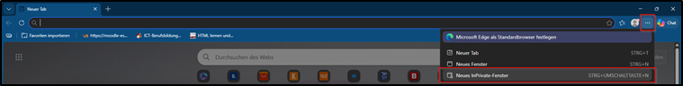
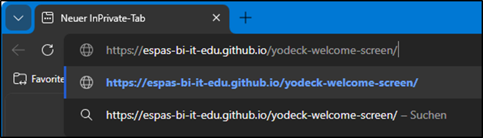

# Yodeck Welcome Screen

Wilkommen beim **Yodeck Welcome Screen Projekt**! Hier wirst Du einfache Änderungen an einer Webseite vornehmen können und lernst einige grundlegende **Git**-Befehle kennen.

## Inhalt

1. [Projekt aufsetzen](#1-projekt-aufsetzen)
    1. [Repository klonen](#11-repository-klonen)
    2. [Eigenen Branch erstellen](#12-eigenen-branch-erstellen)
2. [Code anpassen](#2-code-anpassen)
    1. [Namen und Funktion einfügen](#21-namen-und-funktion-einfügen)
    2. [Farben anpassen](#22-farben-anpassen)
3. [Codeanpassungen pushen](#3-codeanpassungen-pushen)
    1. [Staging](#31-staging)
    2. [Commit](#32-commit)
    3. [Push](#33-push)
4. [Yodeck](#4-yodeck)

* [Weitere Informationen](#weitere-informationen)
  * [Glossar](#glossar)

## 1. Projekt aufsetzen

Damit Du überhaupt mit dem Yodeck-Projekt anfangen kannst, musst Du es zuerst aus dem Internet herunterladen. Code-Projekte werden oftmals in sogenannten **Repositories** auf **GitHub** abgelegt und können von da **geklont** werden.

### 1.1 Repository klonen

Öffne ein Terminal und navigiere zu Deinem persönlichen Ordner auf dem OneDrive:

```sh
cd 'C:\Users\bmschnupperer\OneDrive - ESPAS Stiftung\Schnuppertransfer\Vorname Nachname'
```

> [!WARNING]
> Ersetze im Befehl `Vorname Nachname` mit Deinem eigenen Namen.

Jetzt bist Du am richtigen Ort, um das Projekt herunterzuladen. Mit dem folgenden Befehl erstellst Du eine lokale Kopie, auf welcher Du arbeiten kannst:

```sh
git clone https://github.com/espas-bi-it-edu/yodeck-welcome-screen.git
```

Navigiere nun in den neu erstellten Ordner der Repository:

```sh
cd .\yodeck-welcome-screen
```

### 1.2 Eigenen Branch erstellen

Nun erstellst Du einen eigenen **Branch** (auf deutsch **Ast**), also eine Abspaltung vom Projektstamm (oder `main`-Branch). Wenn Änderungen auf einem Branch gemacht werden sind diese auch nur auf den Branch limitiert, die Arbeit anderer wird dadurch nicht beeinträchtigt. So können Entwickler ihre Features auf eigenen Branches entwickeln, ohne Angst zu haben, dass sie für die anderen etwas kaputt machen.

Führe den folgenden Befehl aus:

```sh
git checkout -b Vorname-Nachname
```

> [!WARNING]
> Ersetze `Vorname-Nachname` mit Deinem eigenen Namen **mit** Bindestrichen dazwischen!

Jetzt hast Du den Branch bei Dir auf dem Computer erstellt. Damit dieser Branch dann aber auch auf der Repository im GitHub existiert, musst Du ihn **pushen**. Verwende dafür den folgenden Befehl:

```sh
git push -u origin Vorname-Nachname
```

> [!WARNING]
> Ersetze `Vorname-Nachname` mit Deinem eigenen Namen **mit** Bindestrichen dazwischen!

## 2. Code anpassen

Öffne nun die Datei `index.html`. Hier kannst du die Struktur und die Inhalte der Yodeck-Welcome-Screen Webseite bearbeiten.

### 2.1 Namen und Funktion einfügen

Suche die folgende Stelle in der `index.html`-Datei und ersetze `Vorname Nachname` mit dem Namen des nächsten Schnupperers. Wende dich an Deine Fachperson, sie wird Dir den Namen sagen.

```html
<!-- Willkommen -->
<div class="card welcome-card">
    <span class="icon bi-person"></span>

    <h2>Herzlich Willkommen in der ESPAS</h2>

    <!-- Name des Schnupperer -->
    <h1 class="name">Vorname Nachname</h1>

    <p>Schön, dass Du heute als Schnupperer bei uns bist!</p>
</div>
```

Füge nun auch noch den Namen und die Funktion des Götti ein.

```html
<!-- Götti -->
<div class="card info-card">
    <span class="icon bi-person-heart" />

    <h2>Dein Götti</h2>

    <!-- Name und Funktion des Götti -->
    <ul>
        <li>Vorname Nachname</li>
        <li>Funktion</li>
    </ul>
</div>
```

> [!TIP]
> Wenn du sehen willst, wie die Webseite mit deinen Änderungen aussieht, dann kannst du sie ganz einfach im Web-Browser öffnen indem du im Windows Explorer die `index.html`-Datei öffnest. Wenn Du weitere Änderungen vornimmst, musst Du die Seite neu laden, damit sie angezeigt werden.

### 2.2 Farben anpassen

Ganz oben in der `index.html`-Daten findest du einige vordefinierte Farben, die du für die nächste Aufgabe verwenden kannst:

```css
:root {
    /* Neutrale Farben */
    --white: #ffffff;
    --light-gray: #e6e6e6;
    --gray: #9da3a8;
    --dark-gray: #555b60;
    --black: #212529;

    /* Farben */
    --blue: #7dbfd4;
    --green: #9adaa9;
    --cyan: #6ed0df;
    --yellow: #f0e266;
    --red: #d17b78;

    --purple: #8171bb;
    --orange: #e0b068;
    --teal: #50a78d;
}
```

```css
/* Hintergrundfarbe */
body {
    background-color: var(--light-gray);
}

/* Kartenfarben */
.card {
    background-color: var(--blue);
    color: var(--black);
}

/* Farbe des Namen */
.name {
    color: var(--yellow);
}
```

## 3. Codeanpassungen pushen

### 3.1 Staging

Als ersten Schritt musst du deine Änderungen **stagen**. Du sagst dem Git-Programm, welche veränderten Dateien hochgeladen werden sollen. Da wir nur die `index.html`-Datei verändert haben, können wir problemlos alle Änderungen stagen. Führe dafür den folgenden Befehl aus:

```sh
git add .
```

> [!TIP]
> Der Punkt bei `git add .` bedeutet, dass ALLE bearbeiteten Dateien für einen Commit staged werden. Wenn nur bestimmte veränderte Dateien in den Commit aufgenommen werden sollten, können diese auch einzeln hinzugefügt werden.
> Beispiel: `git add index.html`

### 3.2 Commit

```sh
git commit -m "Hintergrundfarbe geändert"
```
> [!TIP]
> Der Befehl «git commit -m "Hintergrundfarbe geändert"» erstellt einen neuen Commit in deinem Git‑Repository und speichert alle aktuell vorgemerkten Änderungen (staged changes) zusammen mit der Commit‑Nachricht " Hintergrundfarbe geändert".
> Beispiel: `git commit -m "Hintergrundfarbe geändert"`

### 3.3 Push

```sh
git push
```
> Aktuell sind deine Änderungen nur auf dem lokalen Gerät gespeichert. </br>
> Mit “git push” werden sie auf den Git-Server hochgeladen.


## 4. Aktualisierte Webseite anzeigen
> [!TIP]
> Weil es ein paar Sekunden dauert, bis die Webseite aktualisiert deployt wurde, solltest du etwa eine Minute warten:

### 4.1 InPrivate-Fenster in Microsoft Edge öffnen:



### 4.2 Folgenden Hyperlink in URL von Webbrowser eingeben:

```sh
https://espas-bi-it-edu.github.io/yodeck-welcome-screen/
```


## 4. Yodeck


## Weitere Informationen

### Glossar

| Begriff            | Erklärung                                                                               | Weitere Informationen                                |
| ------------------ | --------------------------------------------------------------------------------------- | ---------------------------------------------------- |
| Git                | ein Versionierungs- und Versionen-Management-Tool                                       | [Git auf W3Schools](https://www.w3schools.com/git/)  |
| GitHub             | ein Cloud-Anbieter, bei welchem Git-Repositories hosted werden können                   |                                                      |
| Visual Studio Code | ein kostenloser Text-Editor, mit welchen man Programmcode erstellen und bearbeiten kann | [Visual Studio Code](https://code.visualstudio.com/) |
